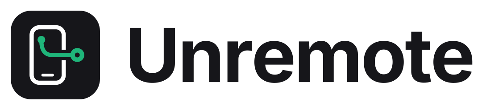
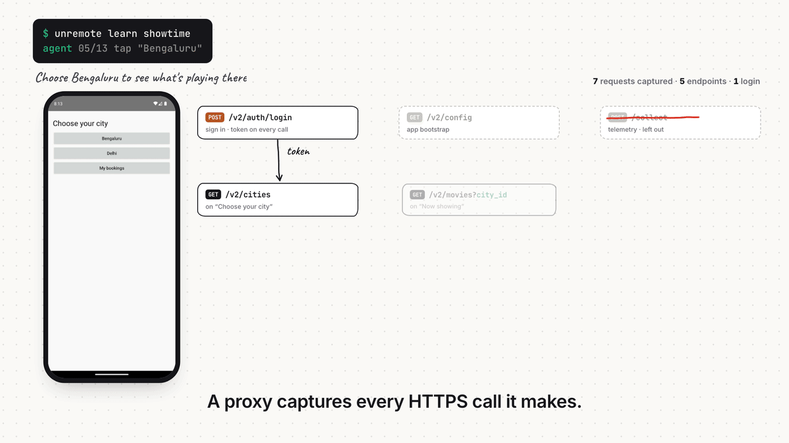
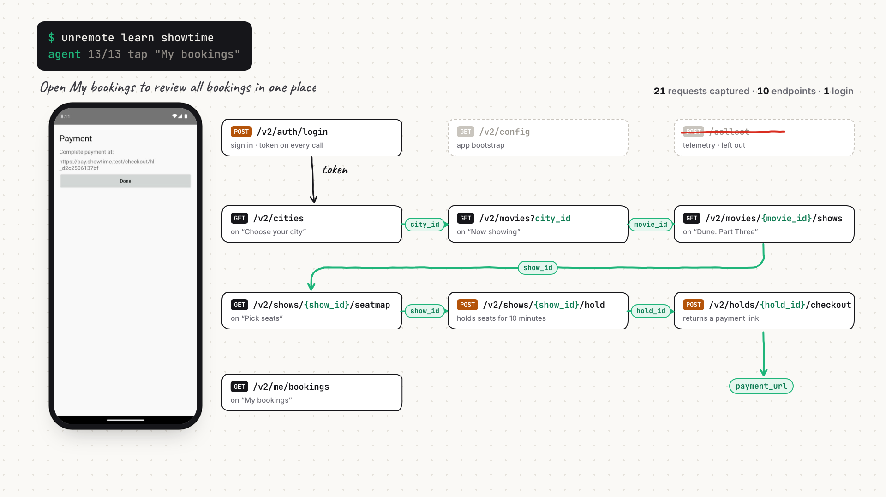

<p align="center"></p>

<p align="center"><b>Any Android app → an MCP server. Scanned once, by the agent itself.</b></p>

<p align="center"></p>

[](https://github.com/pulkitnagpal/unremote/releases/download/v1.0.0/unremote-1.0.mp4)

*Watch the film. Every screen, request and reply in it is from a real run.*

## The problem

Agents are good at using APIs. But most of the services in your day don't have one you can use. Your gym, your
housing society, the EV charger down the road, the cinema, the electricity board: they have a phone app and
nothing else.

The app does have an API. It's private, undocumented, and it's what the app calls every time you tap. Agents
that drive the screen instead are slow (a screenshot and a model call per tap), break when a button moves, and
can't do two things at once.

Unremote finds that private API for you. An agent uses the app on an emulator the way a new user would, while
every HTTPS call is recorded. Unremote works out what each call does and how they connect, then writes a small
MCP server. From then on, Claude Code uses the app through tools like `list_showtimes` and `hold_seats`, with
no screen in the way.

## How you use it

1. **Install the app** on the capture emulator. Use the Play Store on any emulator or phone, then `unremote import`.
2. **`unremote learn <package> <name>`**. The agent reads the store listing, sets itself goals, and uses the
   app for a few minutes. You watch, or you don't.
3. **Ask Claude.** `unremote add <name>` prints the `claude mcp add` line. After that it's just a tool.

## What happened on two apps

### ShowTime (a demo movie-booking app)

ShowTime is a small Android app with its own HTTPS backend, built to behave like a real booking app: login with
short-lived tokens, a startup config call, analytics on every screen, a seat map, seat holds and a payment link.
It's in [`demo/`](demo/).

- The agent turned the store listing into 7 goals and finished all 7 in **12 steps**: it logged in, picked
  Bengaluru, opened a movie, chose a showtime, held seat A1, went to the payment link and stopped there, then
  opened My bookings.
- The recorder captured **21 calls**. The analyzer set aside 11 analytics calls, the startup config and the
  login, and kept 7 endpoints. It also traced every id: the `show_id` in the seat map came from the
  showtimes list, which got its `movie_id` from the movies list.
- Claude designed **7 tools**. All 5 read tools passed against the live API. The 2 write tools were never
  called by the checker.
- Then Claude Code, given only that server and a plain-English request for two seats, held **seats C4–C5 for
  ₹640** and returned the payment link in **69 seconds**. There is no tool that pays: that stays with the human.

### Wikipedia (the real app from the Play Store)

The official Wikipedia app (build 50616, 3 Nov 2026), installed from the Play Store and copied to the capture
emulator with `unremote import`. It was learned with writes blocked and no login.

- The agent set 6 goals from the Play Store listing and finished all 6 in **27 steps** (about 8½ minutes),
  4 of them getting through onboarding. It searched for "Solar System", changed the text size and theme,
  switched the article to Afrikaans, saved it to a new reading list, and browsed the Explore feed.
- The recorder captured 204 requests across 20 hosts. 81 were images, which leaves **123 API calls**. The 55
  analytics posts were held back by the proxy and never reached Wikipedia.
- The analyzer found **26 endpoint patterns**. It folded 15 language subdomains into
  `https://{lang}.wikipedia.org`, split `/w/api.php` into its 8 operations, and set aside the analytics and
  10 style, script and translation endpoints.
- Claude designed **10 read tools**: search, summary, full article, media, languages of an article, list of
  Wikipedias, article info, featured feed, on this day, and random articles. **10/10 passed** against the live API.
- Claude Code, given only that server, was asked for today's featured article, three "on this day" events and
  the Hindi Wikipedia description of the Solar System. It answered all three in **37 seconds**, reading the
  Hindi article through the same `{lang}` tools.
- Reading lists and the reading theme are kept on the phone when you're not signed in. No API call means no tool.

## How it works

| Step | What it does | Model? |
|---|---|---|
| **Explorer** | Reads the screen through Android's accessibility tree and asks Claude for one tap or text entry at a time, toward goals taken from the store listing. Logs every action with a timestamp. | Claude |
| **Recorder** | A mitmproxy addon. The capture emulator trusts mitmproxy as a *system* CA, so a normal release build's HTTPS can be read without patching the app. Writes are held back by default. | — |
| **Analyzer** | Turns raw traffic into an API map: path templates (`/v2/shows/{show_id}/seatmap`), where each value came from, login and refresh, constant headers, fixed query values, and which calls are noise. | — |
| **Designer** | Turns the feature endpoints into a few agent-friendly tools, with descriptions that say where each input comes from. | Claude |
| **Generator** | Writes a standalone Node MCP server: config, a client that replays the API like the app does (headers, login, refresh on 401), and a check per read tool. Large replies are trimmed for the agent (`UNREMOTE_MAX_CHARS`, default 12000). | — |
| **Verify** | Calls every read tool with the arguments the app really used and compares the reply's shape. Never calls write tools. | — |

The analyzer is the part that makes this work, and it's plain Python with no model.
[docs/how-it-works.md](docs/how-it-works.md) walks through every heuristic with examples from these two runs.

## Quickstart

You need a Mac with Apple silicon and:

- [Android Studio](https://developer.android.com/studio) with the SDK, emulator and command-line tools, and the
  `system-images;android-33;google_apis;arm64-v8a` image
- [mitmproxy](https://mitmproxy.org) (`brew install mitmproxy`)
- Node 20+ and Python 3
- [Claude Code](https://claude.com/claude-code), logged in. The explorer and designer call `claude -p`.

```bash
git clone https://github.com/pulkitnagpal/unremote
```

```bash
cd unremote && export PATH="$PWD/bin:$PATH"
```

Boot the capture emulator and add the mitmproxy CA to its system store (only the emulator is changed):

```bash
unremote setup
```

Install an app on a normal emulator or phone from the Play Store, then copy it to the capture emulator:

```bash
unremote import org.wikipedia emulator-5556
```

Save the app's store listing to a text file. The agent sets its goals from it. Then let the agent learn the app:

```bash
unremote learn org.wikipedia wikipedia --listing listings/wikipedia.txt
```

For an app with a login, give the agent a test account. Login calls go through, and other writes stay blocked:

```bash
unremote learn com.example.gym mygym --listing gym.txt --login email=test@example.com,password=your-test-password
```

Check the generated server against the live API, try it on one task, then add it to Claude Code:

```bash
unremote verify wikipedia
```

```bash
unremote try wikipedia "What is today's featured article, and what are three things that happened on this day?"
```

```bash
unremote add wikipedia
```

Login values for a generated server go in `generated/<name>/.env`, as listed in `.env.example`
(`SHOWTIME_EMAIL=…`, `SHOWTIME_PASSWORD=…`). To run the whole thing on the demo app first, see [demo/](demo/).

## Safety

- **Writes are blocked while exploring.** By default every POST, PUT, PATCH and DELETE is answered by the proxy
  with a 403 and never reaches the app's server. Only calls whose path looks like login or auth (`login`, `auth`,
  `token`, `refresh`, `session`) go through.
  `--allow-writes` turns this off. Use it only with a test backend or a throwaway account.
- **Payment is always the human's.** The explorer is told never to type card, UPI or bank details and never to
  confirm a payment. Generated write tools are marked as changing state, and their descriptions tell the agent
  to confirm with you first. Once added with `unremote add`, Claude Code asks your permission before each tool
  call as usual. (`unremote try` pre-approves the server's tools for its one test run.) The most a tool returns is
  a payment link for you to open.
- **Use your own accounts.** Unremote is for apps you use, with accounts you own. It doesn't get around logins,
  limits or anything else the app enforces. Read the app's terms before you automate it.
- **Everything stays local.** The generated server runs on your machine and talks straight to the app's API.
  Captures (`runs/`) hold real tokens and device ids. They're git-ignored, so keep them that way.
  `generated/<name>/unremote.config.json` holds the app's constant headers, which can include a device id.
- **What Claude sees.** The screen text the explorer reads, the test login you pass with `--login`, and the API
  map the designer reads are sent to Claude. The raw capture isn't, but the API map includes example input
  values taken from it.

## Limits

| What the app does | What happens |
|---|---|
| **Certificate pinning** | The app refuses the proxy's certificate, so nothing is captured. Unremote doesn't patch apps to remove pinning. |
| **Request signing** (an HMAC of each request made with a key in the app) | Calls are captured, but replayed calls fail the server's signature check. |
| **Play Integrity / device attestation** | The capture emulator fails attestation, so the app may refuse to log in or to work at all. |
| **Protobuf, gRPC or other binary bodies** | Recorded only as a byte count. There are no fields for the analyzer to trace. |
| **OTP or SMS logins** | The explorer can't get the code, and the generated client can only log in with fixed fields like email and password. |
| **Firebase or Google-hosted backends** | The recorder skips Google hosts so the emulator's own traffic stays out, and an app on Firestore is skipped with it. |
| **Features used once** | A value seen only once may be taken for a fixed value instead of an input. Explore a feature twice to be sure. |

## Compatibility

| App | Result | Notes |
|---|---|---|
| ShowTime (demo) | ✅ | Login, re-login when the token expires, 7 tools, 5/5 read tools verified, seats held and payment link returned by Claude Code in 69 s |
| Wikipedia (Play Store, build 50616) | ✅ / ⚠️ | No login, writes blocked. 10 read tools, 10/10 verified, a three-part question answered in 37 s. Reading lists and theme are on-device only, so there are no tools for them |

Tried it on another app? Open an issue with the app, what worked, and what didn't. Leave out tokens and anything personal.

## Tests

```bash
python3 -m unittest discover tests
```

These test the analyzer on small hand-written captures. Heuristics known to misfire are in `KnownIssues`,
marked as expected failures.

## License

MIT. See [LICENSE](LICENSE).
